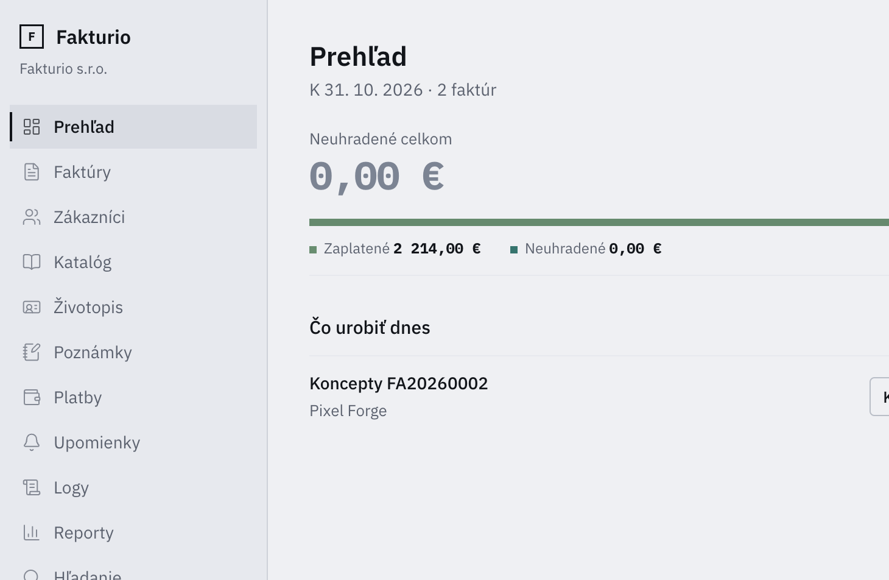
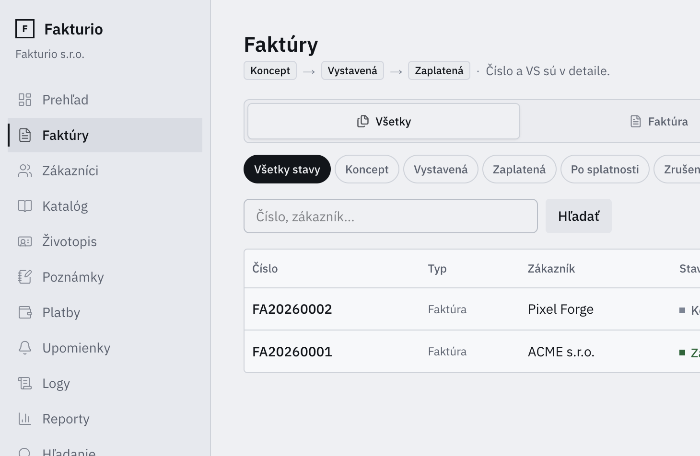
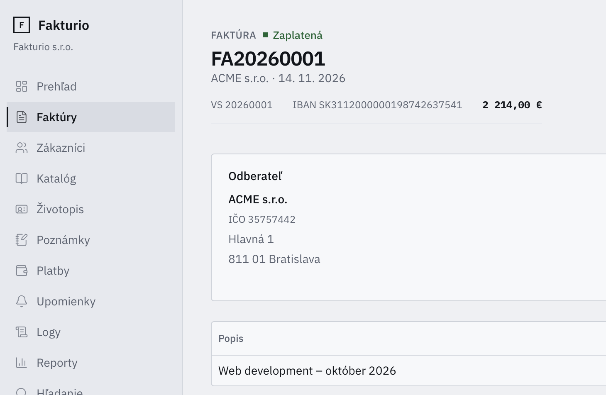
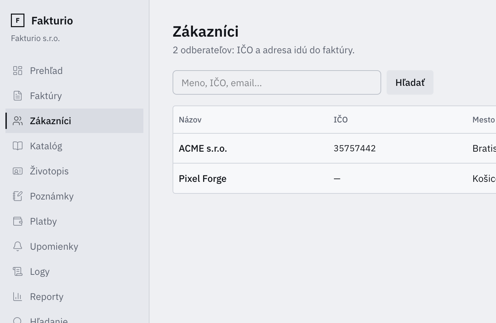
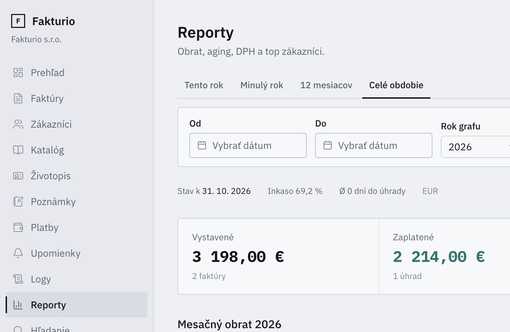

# Fakturio frontend

Next.js App Router (TypeScript) — BFF cez server actions k ASP.NET API.

## Screenshoty

### Prehľad



### Faktúry



### Detail faktúry



### Zákazníci



### Reporty



## Spustenie

```bash
# terminal 1 — API (port 5148)
cd ../backend && dotnet run

# terminal 2 — FE
cp .env.example .env.local   # podľa potreby
npm install
npm run dev
```

Otvor [http://localhost:3000](http://localhost:3000). Pri prázdnej firme ťa appka pošle na `/onboarding`.

## Env

| Premenná       | Default                   |
|----------------|---------------------------|
| `API_BASE_URL` | `http://localhost:5148`   |

## Stack

- Next.js 16 + RSC + server actions
- Tailwind 4 + shadcn/ui
- Zod + react-hook-form
- Sonner toasty
- UI: SK · cesty: EN · industrial/utilitarian
